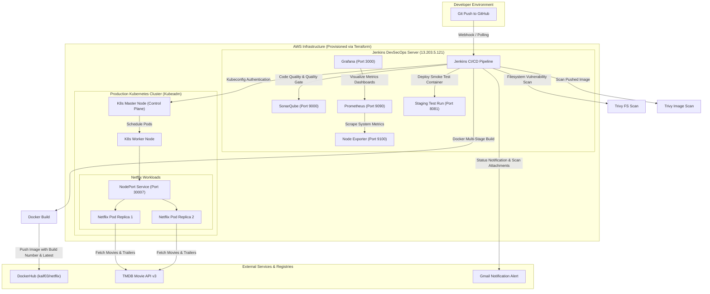

# 🎬 Netflix Clone — End-to-End DevSecOps CI/CD Pipeline on AWS & Kubernetes

[](https://aws.amazon.com/)
[](https://www.terraform.io/)
[](https://www.jenkins.io/)
[](https://www.docker.com/)
[](https://kubernetes.io/)
[](https://www.sonarqube.org/)
[](https://trivy.dev/)
[](https://prometheus.io/)
[](https://grafana.com/)

An enterprise-grade **DevSecOps portfolio project** that automates the provisioning, static code analysis, vulnerability scanning, containerization, and production deployment of a full-featured **Netflix Clone** (React, TypeScript, Material UI, Vite) onto a self-healing **Multi-Node Kubernetes Cluster** on AWS, backed by real-time observability and email alerting.

---

## 🏛 Architecture Diagram



---

## 🚀 Key Features & Highlights

- **Infrastructure as Code (IaC):** Modular Terraform code to automatically configure AWS VPC, Subnets, Security Groups, and launch the Jenkins DevSecOps and Kubernetes Master/Worker EC2 instances in `ap-south-1`.
- **Shift-Left Security (DevSecOps):**
  - **SonarQube:** Code quality analysis, code smells, duplication detection, and Quality Gate evaluation.
  - **Trivy:** Comprehensive filesystem vulnerability scanning and Docker image scanning before promotion to production.
- **Optimized Containerization:** Multi-stage Dockerfile utilizing Node 18 for static bundle generation (Vite + TypeScript) and Nginx Alpine for a secure, ultra-lightweight (<25MB) production web server.
- **Production Kubernetes Orchestration:**
  - **Self-Healing:** Pods automatically recover in seconds if crashes occur.
  - **Zero-Downtime Rolling Updates:** Kubernetes rolls out updates pod-by-pod without dropping active user connections.
  - **Load Balancing (`replicas: 2`):** Traffic on NodePort `30007` is distributed 50/50 across running replicas.
- **Full Observability & Alerting:**
  - Prometheus scraping server metrics (CPU, RAM, Disk, Swap) via Node Exporter.
  - Grafana dashboard visualizing live system health.
  - Automated post-build email reports via Jenkins `emailext` with security scan attachments.

---

## 🛠 Tech Stack & Tools

| Category | Technologies |
| :--- | :--- |
| **Frontend Application** | React 18, TypeScript, Vite, Material UI (MUI), Redux Toolkit, TMDB API v3 |
| **Cloud Infrastructure** | AWS EC2 (`ap-south-1`), VPC, Subnets, Security Groups, Elastic IP |
| **Infrastructure as Code** | Terraform |
| **CI/CD Automation** | Jenkins Declarative Pipeline |
| **Static Code Analysis** | SonarQube Server & SonarScanner CLI |
| **Security Scanning** | Aqua Security Trivy (FS & Image) |
| **Container Engine & Registry** | Docker, DockerHub (`kaif03/netflix`) |
| **Container Orchestration** | Kubernetes (`kubeadm`, `kubelet`, `kubectl` v1.28, Flannel CNI) |
| **Observability & Monitoring** | Prometheus, Grafana, Node Exporter |

---

## 🔁 CI/CD Pipeline Workflow (`Jenkinsfile`)

```text
1. Clean Workspace         ──► Deletes leftover workspace artifacts
2. Checkout from Git       ──► Clones latest code from the main branch
3. SonarQube Analysis      ──► Scans code quality & uploads report to Sonar server
4. Quality Gate            ──► Verifies Quality Gate status ('OK')
5. Install Dependencies    ──► Installs NPM packages (npm install)
6. Trivy FS Scan           ──► Scans codebase files & outputs trivyfs.txt
7. Docker Build & Push     ──► Builds multi-stage image, tags with latest & ${BUILD_NUMBER}, pushes to DockerHub
8. Trivy Image Scan        ──► Scans published Docker image & outputs trivyimage.txt
9. Deploy to Container     ──► Launches local smoke test container on port 8081
10. Deploy to Kubernetes   ──► Applies deployment.yml and service.yml to multi-node K8s cluster
11. Post Actions           ──► Sends build status email with logs & Trivy scan reports
```

---

## 🌐 Endpoints & Service Port Map

| Service | Access URL | Default Port / Type | Purpose |
| :--- | :--- | :--- | :--- |
| **Netflix App (Kubernetes)** | `http://<K8S_WORKER_IP>:30007` | Port `30007` (NodePort) | **Production Live Web App** |
| **Netflix App (Docker)** | `http://<JENKINS_IP>:8081` | Port `8081` (Docker Container) | Staging Smoke Test |
| **Jenkins Console** | `http://<JENKINS_IP>:8080` | Port `8080` (Web UI) | CI/CD Pipeline Dashboard |
| **SonarQube Server** | `http://<JENKINS_IP>:9000` | Port `9000` (Web UI) | Code Quality & Security Gate |
| **Prometheus Monitoring** | `http://<JENKINS_IP>:9090` | Port `9090` (Web UI) | Metrics Scraper & Targets |
| **Grafana Dashboards** | `http://<JENKINS_IP>:3000` | Port `3000` (Web UI) | Live System Dashboards |

---

## 📦 Kubernetes Manifests

Located in the [`Kubernetes/`](./Kubernetes) directory:

- **[`deployment.yml`](./Kubernetes/deployment.yml):**
  - Manages **2 Pod replicas** running `kaif03/netflix:latest`.
  - Configures rolling update strategies and container port `80`.
- **[`service.yml`](./Kubernetes/service.yml):**
  - Exposes pods externally via a **NodePort** service.
  - Maps external port `30007` to container port `80`.

---

## ⚙️ Quickstart & Deployment Guide

### 1. Provision Infrastructure with Terraform
```bash
cd terraform
cp terraform.tfvars.example terraform.tfvars
# Update your aws_region, key_name, and enable_k8s_cluster = true
terraform init
terraform apply
```

### 2. Configure Kubernetes Multi-Node Cluster
On **Master Node** (`K8s-Master`):
```bash
sudo kubeadm init --pod-network-cidr=10.244.0.0/16 --ignore-preflight-errors=NumCPU,Mem
mkdir -p $HOME/.kube
sudo cp -i /etc/kubernetes/admin.conf $HOME/.kube/config
sudo chown $(id -u):$(id -g) $HOME/.kube/config
kubectl apply -f https://raw.githubusercontent.com/flannel-io/flannel/master/Documentation/kube-flannel.yml
```

On **Worker Node** (`K8s-Worker`):
```bash
# Run the join command generated by kubeadm init on the Master:
sudo kubeadm join <MASTER_PRIVATE_IP>:6443 --token <TOKEN> \
    --discovery-token-ca-cert-hash sha256:<HASH> \
    --ignore-preflight-errors=NumCPU,Mem
```

### 3. Add Credentials in Jenkins
1. **DockerHub:** Add username/password credentials with ID **`docker`**.
2. **SonarQube:** Add SonarQube token with ID **`Sonar-token`**.
3. **Kubernetes:** Copy `~/.kube/config` from the Master node and add as a `Secret file` with ID **`k8s`**.

### 4. Trigger the Build
Click **Build Now** in Jenkins. Once the pipeline completes with a green checkmark, access your Netflix web application at:
👉 **`http://<K8S_WORKER_IP>:30007`**

---

## 🧹 Teardown (Clean Resource Deletion)

To avoid ongoing AWS charges when you finish testing:
```bash
cd terraform
terraform destroy
```

---

## 👤 Author

- **Mohammed Kaif Dudhwala**
- **DockerHub:** [kaif03](https://hub.docker.com/u/kaif03)
- **Repository:** [Netflix-secops](https://github.com/kaif2104/Netflix-secops)

